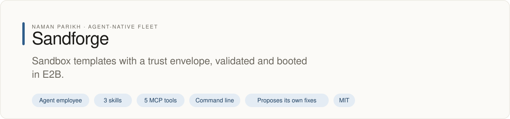
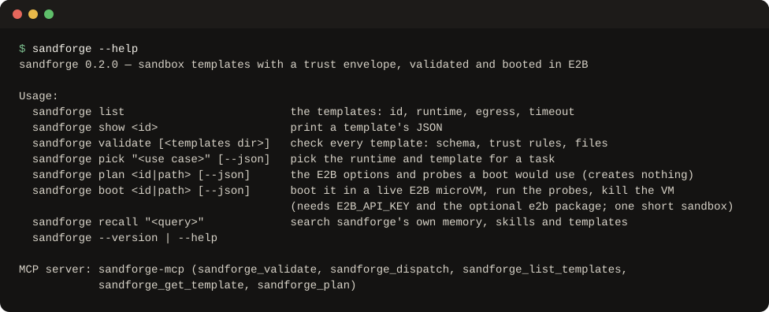

# Sandforge

<!-- fleet:header:start -->
<p align="center"><picture><source media="(prefers-color-scheme: dark)" srcset="assets/banner-dark.svg"></picture></p>

<p align="center">
<a href="https://github.com/naman10parikh/sandforge/actions/workflows/ci.yml"></a>
<a href="https://github.com/naman10parikh/sandforge/releases"></a>
<a href="LICENSE"></a>
<a href="#use-it-from-any-coding-agent"></a>
<a href="https://x.com/naman10parikh"></a>
<a href="https://www.linkedin.com/in/naman-parikh1/"></a>
</p>

<p align="center"><a href="#quick-start">Quick start</a> · <a href="docs/README.md">How it works</a> · <a href="AGENTS.md">AGENTS.md</a> · <a href="llms.txt">llms.txt</a> · <a href="skills/">Skills</a> · <a href="https://github.com/naman10parikh/sandforge/discussions">Discussions</a> · <a href="https://github.com/naman10parikh">All projects</a></p>

**Sandbox templates with a trust envelope, validated and booted in E2B.**

Sandforge is an agent employee, a packaged specialist agent with its own skills, memory and tests. It owns one job: sandbox / Infra. Coding agents use it through its skills, its MCP server and its command line. A scheduled job runs its evals and proposes fixes. A person makes every change.

_Sandforge is part of an agent-native play for agent-native systems that can eventually be recursively self-improving and evolving, operated by agent employees._

<p align="center"></p>
<!-- fleet:header:end -->

Sandforge ships sandbox templates, an E2B Firecracker microVM and a devcontainer, and writes down each one's trust envelope: network egress, mounts, secrets, capabilities, limits and cost. It checks every template against a schema and trust rules, picks the right runtime for a task, and boots an E2B template in a live microVM to confirm that the envelope holds. It is for people and agents who run untrusted or model-written code and want the rules stated and verified.

<!-- fleet:use:start -->
## Use it from any coding agent

**Claude Code**: the plugin brings the skills, sub-agents, hooks and MCP server.

```
/plugin marketplace add naman10parikh/sandforge
/plugin install sandforge@sandforge
```

<details><summary>Its MCP server, Codex, Cursor, Gemini CLI, one skill and the command line</summary>

**Its MCP server**, in any MCP client:

```bash
claude mcp add --transport stdio sandforge -- npx -y -p github:naman10parikh/sandforge sandforge-mcp
codex mcp add sandforge -- npx -y -p github:naman10parikh/sandforge sandforge-mcp
```

Cursor (`.cursor/mcp.json`), Gemini CLI (`.gemini/settings.json`) and most other clients take the same command as JSON:

```json
{
  "mcpServers": {
    "sandforge": {
      "command": "npx",
      "args": [
        "-y",
        "-p",
        "github:naman10parikh/sandforge",
        "sandforge-mcp"
      ]
    }
  }
}
```

**Gemini CLI**: the extension brings the context and the MCP server.

```bash
gemini extensions install https://github.com/naman10parikh/sandforge
```

**One skill** (3 in all, in [skills/](skills/)), in any agent that reads Agent Skills:

```bash
gemini skills install https://github.com/naman10parikh/sandforge --path skills/template-validate
git clone --depth 1 https://github.com/naman10parikh/sandforge /tmp/sandforge && cp -r /tmp/sandforge/skills/template-validate ~/.claude/skills/
```

**The command line:**

```bash
npx -y -p github:naman10parikh/sandforge sandforge --help
```

</details>

Codex, Cursor, OpenCode, GitHub Copilot and other agents read [AGENTS.md](AGENTS.md); Claude Code reads [CLAUDE.md](CLAUDE.md) and Gemini CLI reads [GEMINI.md](GEMINI.md), which import it. [llms.txt](llms.txt) maps every surface for agents that read first.
<!-- fleet:use:end -->

## Quick start

From a clone (Node 18 or newer; the tests and evals need nothing installed):

```bash
git clone https://github.com/naman10parikh/sandforge && cd sandforge
npm test && npm run eval      # 18 tests pass (the live boot is skipped), 2 templates, 21 golden cases
node bin/sandforge.mjs list                               # the templates, their egress and limits
node bin/sandforge.mjs pick "run an untrusted eval script"  # e2b → e2b-default
node bin/sandforge.mjs plan e2b-default                   # the exact Sandbox.create options and probes
```

To prove a template in a live microVM, install the optional E2B SDK and give it your key. One boot is one
short sandbox on your E2B account:

```bash
npm install
E2B_API_KEY=your-key node bin/sandforge.mjs boot e2b-default
```

Without a clone, every command also runs as `npx -y -p github:naman10parikh/sandforge sandforge <command>`.

## How it works

**Templates.** Each template is a folder in `templates/` with a `template.json` and a README. The JSON names a
runtime (`e2b`, `devcontainer`, `microsandbox`, `daytona` or `fly-machines`), its compute and cost, the tools it
promises, and its trust envelope. Callers may narrow an envelope. Widening one needs a `trust-gate-v{N}.md` in the
template folder and a person's review.

**The validator** (`eval/run.mjs`, also `sandforge validate`) checks every template against
`eval/schema/template.schema.json` and these trust rules:

- Declare `compute.timeoutSeconds` and `compute.estimatedHourlyCost`.
- Set `trustEnvelope.allowNetworkEgress` explicitly.
- If `allowNetworkEgress=false`, keep `allowedEgressDomains` empty.
- If `allowNetworkEgress=true`, explain why in `trustEnvelope.notes`.
- Declare `trustEnvelope.capAdd`, even if empty, and never add SYS_ADMIN, NET_ADMIN, SYS_PTRACE, SYS_MODULE,
  DAC_READ_SEARCH or ALL.
- Keep status `active`; a deprecated template moves to `templates/archive/`.

A stray key in `compute`, `trustEnvelope` or a tool entry also fails, so a typo cannot pose as a setting. The
golden cases in `eval/golden.json` keep 11 known-bad templates failing for the stated reason. In Claude Code, the
hook `hooks/template-guard.mjs` checks a `template.json` after every edit and blocks a `git commit` while any
template fails.

**The boot** (`lib/boot.mjs`, `sandforge boot`) turns an e2b template into E2B's `Sandbox.create` options: the E2B
template name (`base` is E2B's default), the timeout, and `allowInternetAccess: false` for no egress or
`network.allowOut` plus a deny-all rule for an allowlist. Inside the VM it checks each promised tool and version,
tries a request to an outside host, and lists the environment's variable names to make sure no undeclared secret is
present. Then it kills the VM, even when a probe fails. The first boot, on 19 October 2026, was ready in 321 ms. It
found git 2.39.5 and 2 vCPU where the template promised git 2.40 and 1 vCPU, so e2b-default 1.1.0 now declares what
the VM has. The details are in [templates/e2b-default/README.md](templates/e2b-default/README.md).

A boot costs money, so CI never runs one: `npm test` skips the live test unless `SANDFORGE_LIVE_E2B=1` is set, and
the MCP server's tools only plan.

**Routing** (`dispatch/pick-runtime.mjs`, `sandforge pick`, `sandforge_dispatch`) matches whole words in a task
description against each runtime's keywords; the runtime with the most matches wins and a tie goes to the stricter
one. Darwin's eval runs and Helios's scripts are the kind of short, untrusted work that lands on `e2b-default`.

**Memory and logs.** `identity/MEMORY.md` holds the decisions and the trust invariants, `identity/LEARNINGS.md`
turns each correction into a rule, and `sandforge recall "<query>"` searches both, the skills, the sub-agents and
the template READMEs. Every CLI command and MCP call appends a line to `observability/run-log.jsonl`.

The infra choices it implements come from the Energy repository's `INFRA-STACK.md`. The nightly loop watches the
other upstream, the E2B SDK, and opens an issue when the options the boot uses change.


<!-- fleet:anatomy:start -->
## What it is made of

Every project in this fleet is graded on the same 11 harness components and on self-improvement. Each mark is backed by a file you can open.

| Component | Grade | Where |
| --- | --- | --- |
| Identity | ✅ | identity/SOUL.md:5 persona Sandforge, boundaries at :37 |
| Memory | ✅ | identity/MEMORY.md:1 |
| Skills | ✅ | skills/template-validate/SKILL.md:2, skills/template-scaffold/SKILL.md:2, skills/sandbox-boot/SKILL.md:2 |
| Tools/CLIs | ✅ | package.json:11 bin sandforge → bin/sandforge.mjs |
| Hooks | ✅ | .claude/settings.json:3 PreToolUse Bash and :15 PostToolUse edits → hooks/template-guard.mjs |
| Sub-agents | ✅ | .claude/agents/trust-auditor.md:2 |
| MCPs | ✅ | mcp/server.mjs:76 five tools |
| Dispatch | ✅ | dispatch/pick-runtime.mjs:82 whole-word, most-matches routing, shared by bin/sandforge.mjs pick and the sandforge_dispatch tool |
| Evals | ✅ | package.json:17 eval = eval/run.mjs |
| Observability | ✅ | observability/append-run.mjs:43 appendRun, called by bin/sandforge.mjs:77 and mcp/server.mjs:154 |
| Sandbox/Infra | ✅ | lib/boot.mjs:140 Sandbox.create with options from the template |
| Self-improvement | ✅ | dsip.json:1 L2 |

✅ real and tested · 🟡 partial, with the reason in the row · ❌ absent
<!-- fleet:anatomy:end -->

<!-- fleet:footer:start -->
## How it improves itself

It carries its own evals and a self-improvement contract, [`dsip.json`](dsip.json), which says what it may change and how a change is judged. A scheduled job runs its evals and proposes fixes. A person makes every change. Lessons it learns are kept as rules in its memory files.

## Part of a fleet

One of the projects by [Naman Parikh](https://github.com/naman10parikh). Each owns one part of an agent's harness, or of the product around an agent, and all of them follow one standard.

| Related project | What it owns |
| --- | --- |
| [AgentDial](https://github.com/naman10parikh/agentdial) | Identity |
| [WikiMem](https://github.com/naman10parikh/wikimem) | Memory |
| [Skillsmith](https://github.com/naman10parikh/skillsmith) | Skills |
| [Agent Booster](https://github.com/naman10parikh/agent-booster) | Tools / CLIs |
| [Armory](https://github.com/naman10parikh/armory) | MCPs and the component registry |
| [AgentGrid](https://github.com/naman10parikh/agentgrid) | Dispatch |
| [AgentSwarm](https://github.com/naman10parikh/agentswarm) | Dispatch |
| [AgentBench](https://github.com/naman10parikh/agentbench) | Evals |
| [AgentMoney](https://github.com/naman10parikh/agentmoney) | Observability |
| [Claude Harness](https://github.com/naman10parikh/claude-harness) | The whole harness, as a template |

## Community

Questions and ideas go to [Discussions](https://github.com/naman10parikh/sandforge/discussions); bugs go to [issues](https://github.com/naman10parikh/sandforge/issues/new/choose). Follow the work on [X](https://x.com/naman10parikh) and [LinkedIn](https://www.linkedin.com/in/naman-parikh1/).

## Contributing and security

Read [CONTRIBUTING.md](CONTRIBUTING.md). AI-assisted pull requests are welcome. Report a vulnerability privately, as [SECURITY.md](SECURITY.md) explains.

## License

MIT, © 2026 Naman Parikh. See [LICENSE](LICENSE) and [NOTICE](NOTICE).
<!-- fleet:footer:end -->
