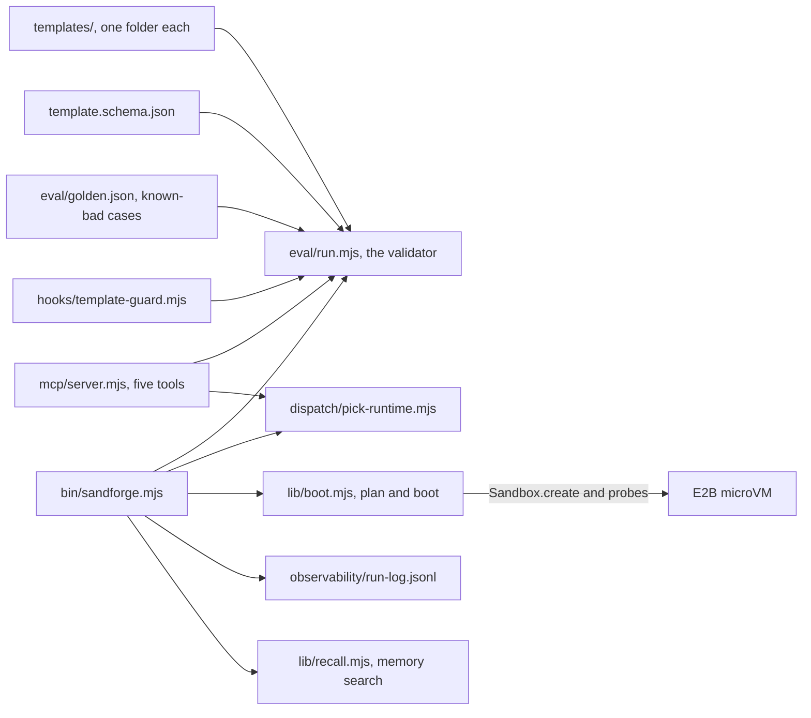

# How Sandforge works

Sandforge keeps sandbox templates honest. A sandbox is an isolated machine where an agent can run code it should not run on your computer. Each template declares a runtime, its compute and cost, the tools it promises, and a trust envelope. The trust envelope is the template's limits on outbound network access (egress), host mounts, secrets and Linux capabilities. Sandforge validates every template against a schema and trust rules. It picks a runtime for a task. It can also boot a template in an E2B microVM, a small isolated cloud machine, to prove the declaration holds. It is for people and agents who need to run untrusted work safely.

## The parts

Each template lives in [templates/](../templates/) as a `template.json` and a README. [eval/run.mjs](../eval/run.mjs) is the validator. It checks each template against [eval/schema/template.schema.json](../eval/schema/template.schema.json) and the trust rules in `checkTrustInvariants`. Closed egress must list no allowed domains. Open egress must explain why in its notes. No template may add a dangerous capability such as `SYS_ADMIN`. An unknown key also fails, so a typo cannot pose as a setting. [eval/golden.json](../eval/golden.json) holds known-bad templates that must keep failing for the stated reason.

[bin/sandforge.mjs](../bin/sandforge.mjs) is the command line. [dispatch/pick-runtime.mjs](../dispatch/pick-runtime.mjs) matches whole words in a task description against each runtime's keywords. The most matches win, and a tie goes to the stricter runtime. [lib/boot.mjs](../lib/boot.mjs) turns an e2b template into E2B's create options and the checks to run inside the VM. [mcp/server.mjs](../mcp/server.mjs) is an MCP server: MCP (Model Context Protocol) is the standard way coding agents call outside tools. Its five tools validate, pick, list, show and plan, but never boot. [hooks/template-guard.mjs](../hooks/template-guard.mjs) checks a template after every edit. In this repository's [.claude/settings.json](../.claude/settings.json), it also blocks a `git commit` while any template fails. [lib/recall.mjs](../lib/recall.mjs) searches the project's own memory, skills and template READMEs. `validate`, `pick`, `plan`, `boot` and every MCP call append one line to [observability/run-log.jsonl](../observability/run-log.jsonl).

## What happens when you run it

1. `sandforge boot e2b-default` runs [bin/sandforge.mjs](../bin/sandforge.mjs). `loadTemplate` in [lib/boot.mjs](../lib/boot.mjs) finds the template by id or by path.
2. `validateTemplateDir` from [eval/run.mjs](../eval/run.mjs) checks the schema, the trust rules and the files. A failing template stops here.
3. Only `e2b` templates go on. `toE2BOptions` builds the `Sandbox.create` options: the E2B template name, the timeout and the network rules.
4. Closed egress becomes `allowInternetAccess: false`. An allowlist becomes `network.allowOut` with a deny-all rule.
5. `probesFor` lists the checks to run inside the VM. They cover each promised tool and its version, egress closed or open as declared, and secret-looking variable names.
6. `bootInE2B` loads the optional `e2b` package, creates the VM and times the cold start. It runs each probe, and `judge` compares the result with the declaration.
7. The VM is killed in a `finally` block, even when a probe fails. The secrets probe reads variable names only, never their values.
8. The command line prints each probe's result. [observability/append-run.mjs](../observability/append-run.mjs) appends the outcome to the run log.

`sandforge plan e2b-default` stops after step 5 and prints the options and probes. It creates nothing.

## Extending it

- **A template.** Follow [skills/template-scaffold/SKILL.md](../skills/template-scaffold/SKILL.md). Add `templates/<id>/` with a `template.json` whose `id` matches the folder, and a `README.md`. A devcontainer template also needs a `devcontainer.json`. Start from the strictest envelope.
- **A wider envelope.** Add a `trust-gate-v{N}.md` to the template folder. Ask the trust-auditor sub-agent in [.claude/agents/trust-auditor.md](../.claude/agents/trust-auditor.md) for a review, and a person approves it.
- **A trust rule.** Add it to `checkTrustInvariants` in [eval/run.mjs](../eval/run.mjs). Add a case to [eval/golden.json](../eval/golden.json) that must fail for the new reason.
- **A runtime route.** Add keywords to `RULES` in [dispatch/pick-runtime.mjs](../dispatch/pick-runtime.mjs), and a dispatch case to [eval/golden.json](../eval/golden.json).
- **A command or MCP tool.** Add a branch to `run()` in [bin/sandforge.mjs](../bin/sandforge.mjs), or a tool to [mcp/server.mjs](../mcp/server.mjs). Cover it in [tests/cli.test.mjs](../tests/cli.test.mjs).
- **A skill.** Add `skills/<name>/SKILL.md` beside the three in [skills/](../skills/).

Then run `npm test && npm run eval`. CI runs both on every push and pull request, in [.github/workflows/ci.yml](../.github/workflows/ci.yml).

## Questions

**Does it need an API key or cost money?** `list`, `show`, `validate`, `pick`, `plan` and `recall` need only Node 18 or newer. `boot` needs `E2B_API_KEY` and the optional `e2b` package. One boot is one short sandbox on your E2B account. The e2b-default template declares an estimated $0.05 per vCPU-hour.

**Does any data leave the machine?** Only `boot` talks to a service: it creates an E2B sandbox and runs the probe commands there. The MCP server never boots. In CI, the nightly drift check reads the npm registry and unpkg. Everything else stays local.

**How does it improve itself?** Its [dsip.json](../dsip.json) meets DSIP level L2, and Darwin's DSIP checker verifies L2 from the repository. A nightly workflow, [.github/workflows/improve.yml](../.github/workflows/improve.yml), runs the tests and evals. Then [scripts/sdk-drift.mjs](../scripts/sdk-drift.mjs) compares the newest E2B SDK with the options the boot relies on. On a change, the workflow opens an issue for a person. It is not L3, because its selection rule is performance only.

**How do I run its tests and evals?** `npm test` runs the Node tests in [tests/](../tests/). The live boot test is skipped unless `SANDFORGE_LIVE_E2B=1` and `E2B_API_KEY` are set. `npm run eval` runs the validator on every template, then [eval/golden.mjs](../eval/golden.mjs) on the golden cases.

**What does it not do?** Only e2b templates boot. The devcontainer template is validated but never started. microsandbox, Daytona and Fly Machines have routing rules but no templates yet. No code checks for the trust-gate file: that review is a rule for the sub-agent and a person. It proves a template's envelope, it does not run your workload.
